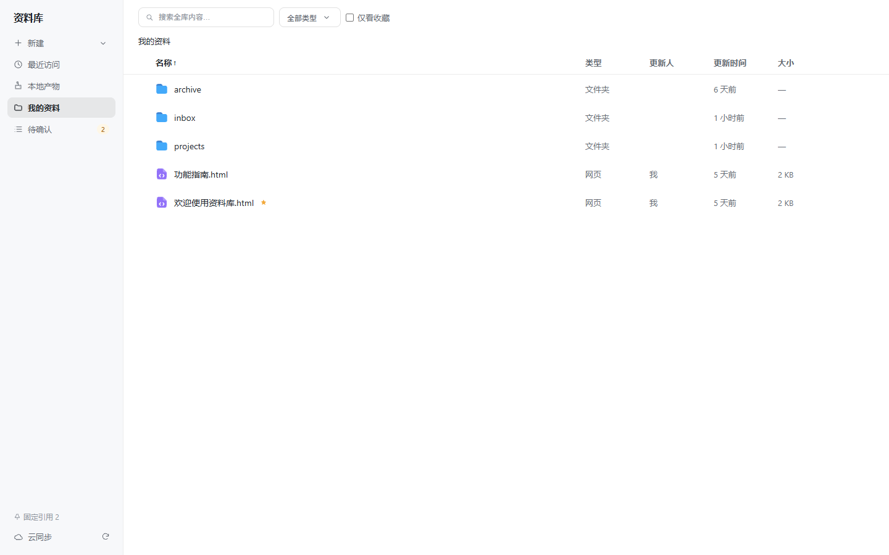
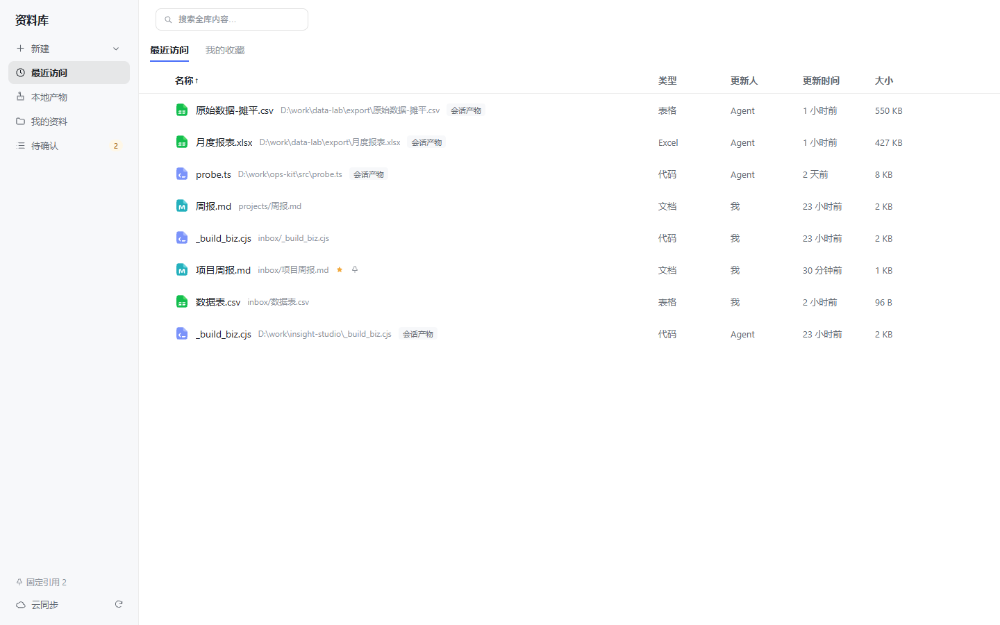
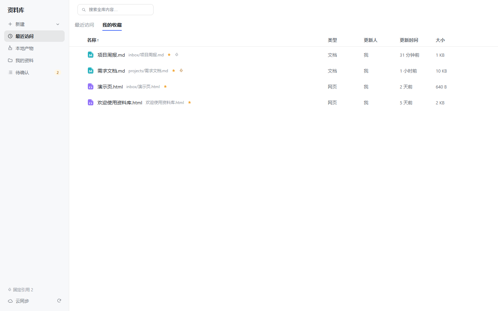
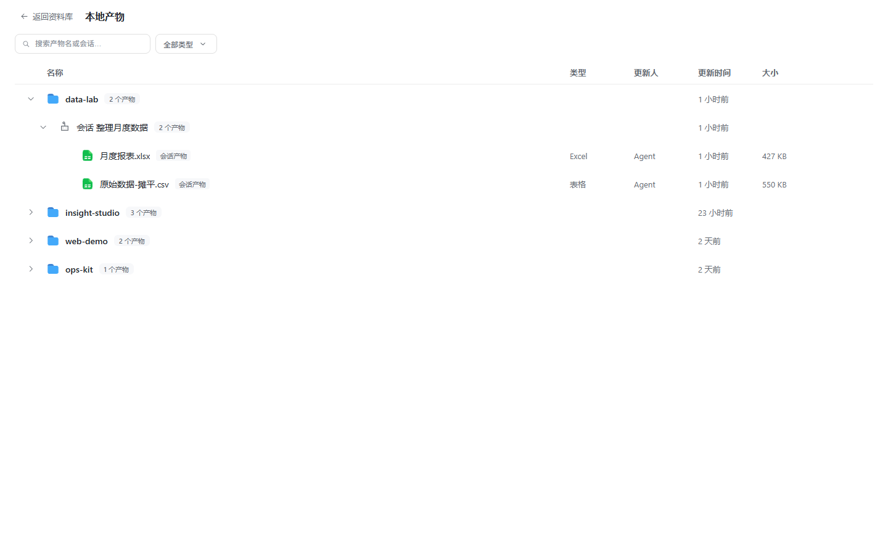
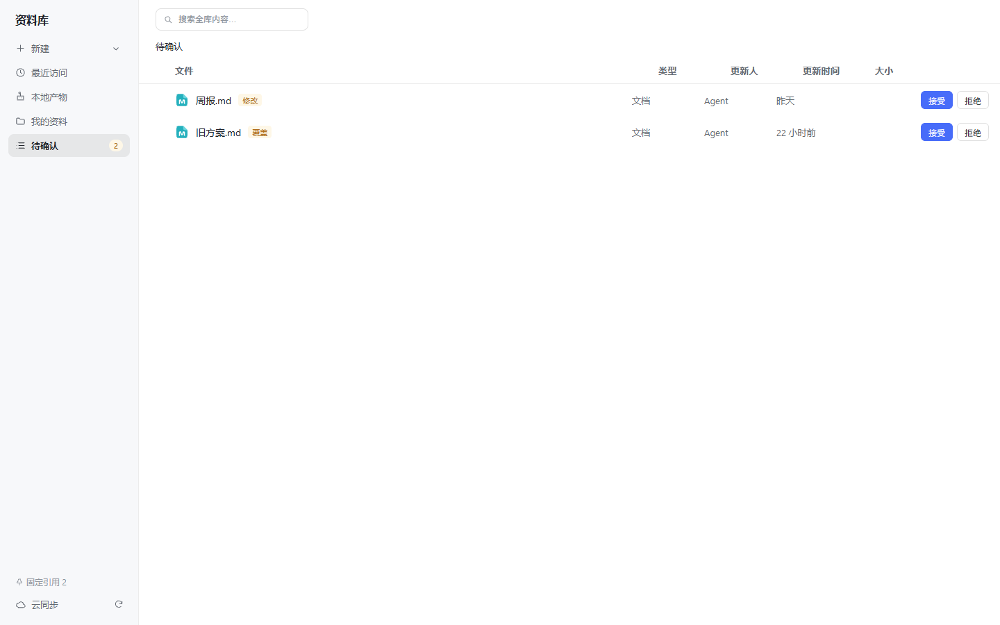
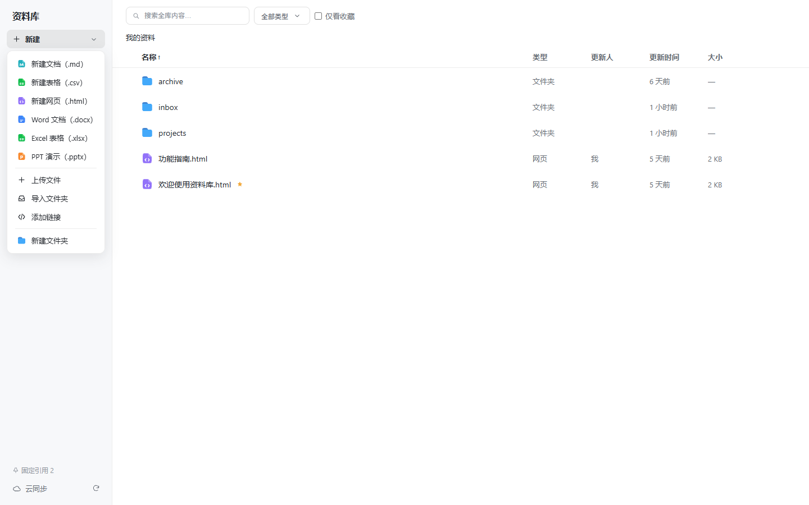

# dsh-wb-desk · Library

English | [中文](./README.md)

An artifact space for agents: instead of scattering generated files across session workspaces, files are filed automatically, manageable, and reusable. A DSH plugin modeled on the WorkBuddy library.



## Features

- **Graded writes**: new files written by an agent land immediately; edits to existing library files go through a persistent "Pending" queue and only overwrite the original after you accept them (rejected versions are archived)
- **Automatic filing**: agent outputs written outside the library are copied in according to configurable rules (matched by session / workspace, default `inbox/`, editable under "Auto filing" in the panel), with timestamps added on name collisions — nothing is overwritten
- **Pinned revisions**: the first time an agent reads a library file, that revision is pinned; if the file changes later the agent still reads the pinned revision and is warned about drift. Release the pin from the panel in one click; pins older than the retention window (7 days after the session ends by default) are released automatically
- **Local artifacts**: all agent outputs grouped by workspace → session → file, with a side drawer preview
- **Recent / Favorites**: opened files are recorded (library files and session artifacts marked separately); favorites are aggregated across the whole library
- **Folder management**: recursive tree, text preview, whole-library line search, create/rename/move/delete, upload; deleted items go to a recycle bin (Recent → Recycle bin) where they can be restored or purged one by one or in bulk, and items older than 30 days are cleaned up automatically
- **Binary fallback**: files that can't be previewed (PDF/Office/images/media) offer "Open with default app" and "Show in folder" actions
- **Useful out of the box**: built-in document/sheet/web/folder plus empty Word/Excel/PPT templates that open in your local Office
- **Optional cloud sync**: Tencent COS mirror, local-first, auto-push after writes. Single-user backup only, no collaboration

| Recent | Favorites |
| --- | --- |
|  |  |

| Local artifacts | Pending |
| --- | --- |
|  |  |



## How it works

- Hooks into the `tools/pre-execute` / `tools/post-execute` waterfalls for write grading and filing; applies only to write / edit / read **tool calls**
- Files are plain files under the library root; plugin metadata lives in `library/.dsh-library/`
- Local artifacts are indexed incrementally from DSH session logs (`~/.dsh/sessions`) by mtime, so agents don't have to report anything

## Install

```
dsh plugin --profile desktop add github:elegant01/dsh-wb-desk
```

Fully quit DSH (including the tray background process) and restart.

## Data and privacy

- Files live under `$DSH_HOME/library/` (override with `DSH_WB_DESK_ROOT`) and can be opened by any program
- Pending queue, pin snapshots and artifact index are stored in `library/.dsh-library/` and excluded from cloud sync
- Cloud sync only uploads files in "My files"; `inbox/` and session artifacts are not uploaded
- No telemetry

## Non-goals

- No online publishing or public hosting
- No real-time collaboration or shared spaces
- No RAG / vector search
- No in-browser Office editing (use the empty templates with your local Office)
- Unrelated to `dsh-wb` (WorkBuddy bridge) and `dsh-desk` (desktop edition); the similar names are coincidental

## License

MIT
