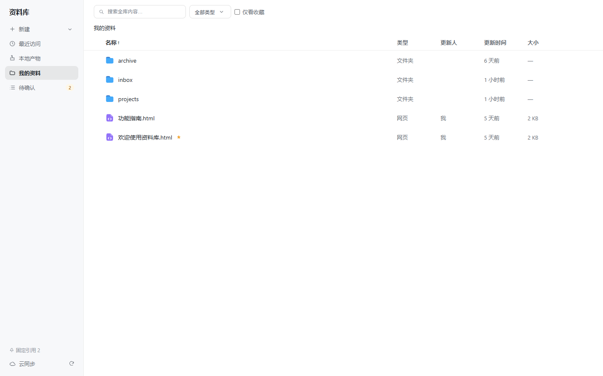
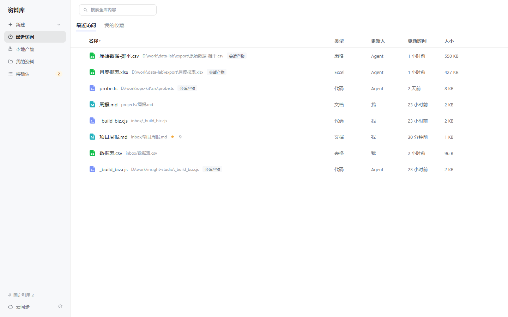
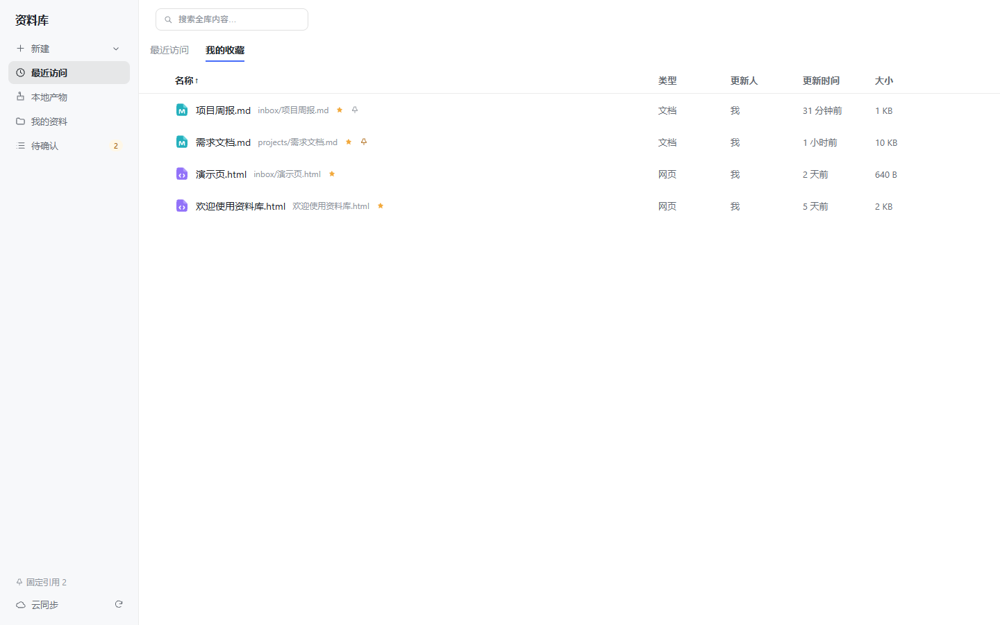
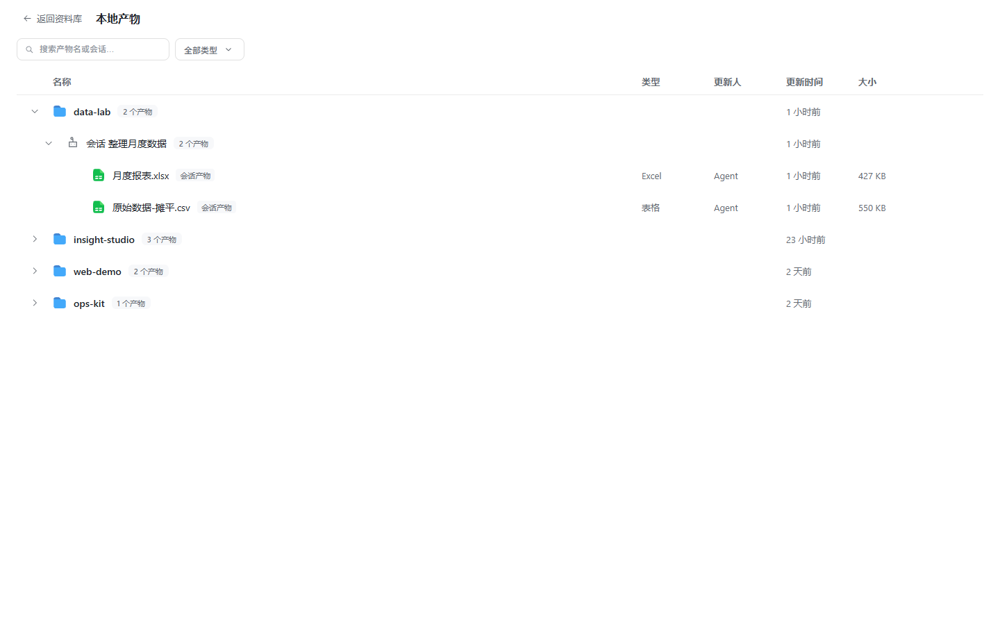
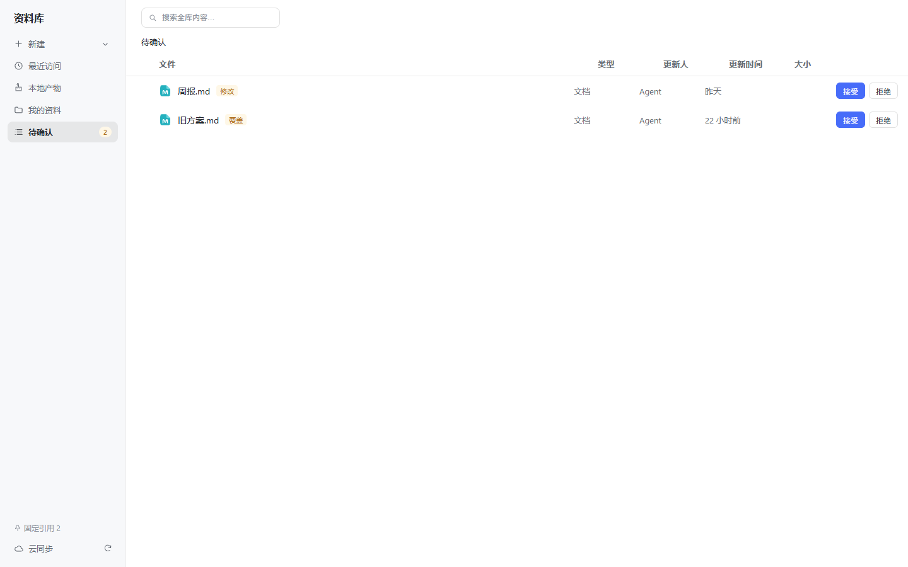
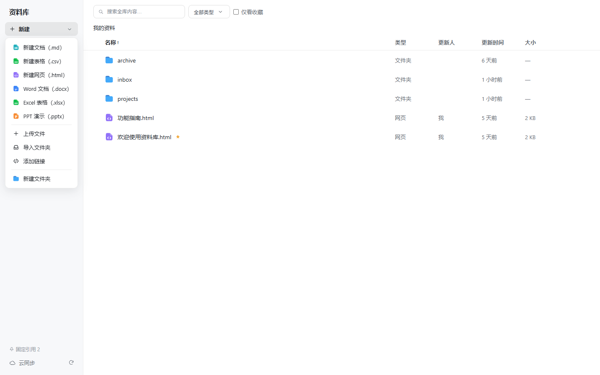

# dsh-wb-desk · 资料库

**中文** | [English](./README.en.md)

Agent 原生产物空间：让 Agent 产出的文件不再散落在各会话工作区，而是自动归位、可管理、可继续读取加工。对标 WorkBuddy 资料库的 DSH 插件。



## 功能

- **分级写入**：Agent 新建文件免确认自动落盘；修改库内已有文件先进入持久化「待确认」队列，你在面板里接受后才覆盖原文（拒绝的内容留档可找回）
- **自动归位**：Agent 写到库外的产出，按可配置规则归位一份副本（按会话 / 工作区匹配，默认 `inbox/`，在面板「自动归位」里编辑）；重名自动加时间戳，不覆盖旧文件
- **固定修订引用**：Agent 首次读取库内文件时固定该时刻版本；文件随后被修改，Agent 读到的仍是固定版本并收到漂移提示，面板可一键释放；会话结束超过保留期（默认 7 天）的固定引用自动释放
- **本地产物视图**：按「工作区 → 会话 → 文件」三级汇总所有 Agent 产出，点文件右侧抽屉直接预览
- **最近访问 / 我的收藏**：打开过的文件自动进最近访问（库内文件与会话产物分开标记）；收藏跨全库汇总，任意目录的收藏都在同一页
- **目录管理**：递归目录树、文本预览、全库按行搜索、新建/重命名/移动/删除、上传；删除进回收站，可单条或批量恢复/彻底删除（「最近访问 → 回收站」），删除满 30 天自动清理
- **二进制文件兜底**：PDF/Office/图片/音视频等不支持预览的文件，详情页可一键「用默认应用打开」或「打开所在文件夹」（资源管理器中定位）
- **新建即用**：内置文档/表格/网页/文件夹与 Word/Excel/PPT 空模板，创建后可直接用本机 Office 打开
- **云同步（可选）**：腾讯云 COS 镜像，本地优先、写入后自动推送，只做单用户备份，不做多人协作

| 最近访问 | 我的收藏 |
| --- | --- |
|  |  |

| 本地产物 | 待确认 |
| --- | --- |
|  |  |



## 工作原理

- `tools/pre-execute` / `tools/post-execute` 两个 waterfall 挂点做写入分级与归位，只作用于 write / edit / read 类**工具调用**
- 文件本体是普通文件，直存库目录；插件自己的元数据收在 `library/.dsh-library/`
- 本地产物通过解析 DSH 会话日志（`~/.dsh/sessions`）按 mtime 增量索引，不需要 Agent 上报

## 安装

从 npm 安装：

```sh
dsh plugin --profile desktop add dsh-wb-desk
```

或直接从 GitHub 安装（跟随 main 分支最新提交）：

```sh
dsh plugin --profile desktop add github:elegant01/dsh-wb-desk
```

完整退出 DSH（含托盘后台进程）后重启生效。

## 数据与隐私

- 文件直存 `$DSH_HOME/library/`（`DSH_WB_DESK_ROOT` 可覆盖），库外任何程序都能直接打开
- 待确认队列、pin 快照、产物索引都在 `library/.dsh-library/` 隐藏目录，不参与云同步
- 云同步只上传「我的资料」中的文件；`inbox/` 与会话产物默认不上云
- 不做任何遥测上报

## 明确的边界

- 无在线发布（无公网托管能力）
- 无多人实时协同编辑 / 共享空间
- 无 RAG / 向量检索
- 不做 Office 文档在线编辑（新建的空模板请用本机 Office 打开）
- 与 `dsh-wb`（WorkBuddy 桥接插件）、`dsh-desk`（桌面发行版）无任何关联，名字相邻纯属查找时的巧合

## License

MIT
